<div align="center">



# ⚡ Awesome Virtualization Platforms

### A Curated Directory of Hypervisors, Virtual Machine Engines, Private Cloud Stacks & Data Center Virtualization

<p align="center">
  <a href="https://github.com/ishandutta2007/Awesome-Awesome-Awesome"></a><a href="https://discord.gg/jc4xtF58Ve"></a>
  <a href="https://github.com/ishandutta2007/Awesome-Virtualization-Platforms/stargazers"></a>
  <a href="https://github.com/ishandutta2007/Awesome-Virtualization-Platforms/network/members"></a>
  <a href="https://github.com/ishandutta2007/Awesome-Virtualization-Platforms/issues"></a>
  <a href="https://github.com/ishandutta2007/Awesome-Virtualization-Platforms/pulls"></a>
  <a href="LICENSE"></a>
  <a href="https://github.com/ishandutta2007"></a>
</p>

<p align="center">
  <strong>Explore the leading enterprise SaaS virtualization suites, bare-metal hypervisors (Type-1), hosted hypervisors (Type-2), microVM sandboxes, and open-source private cloud control planes.</strong>
</p>

</div>

---

## 📑 Table of Contents

- [🌐 Sector Overview & Market Dynamics](#-sector-overview--market-dynamics)
- [🏢 SaaS & Commercial Virtualization Platforms](#-saas--commercial-virtualization-platforms)
- [🐧 Open-Source Virtualization Projects (Ranked by Stars)](#-open-source-virtualization-projects-ranked-by-stars)
- [🏛️ Architectural Classifications](#️-architectural-classifications)
  - [Type-1 Bare-Metal Hypervisors](#1-type-1-bare-metal-hypervisors)
  - [Type-2 Hosted Hypervisors & Emulators](#2-type-2-hosted-hypervisors--emulators)
  - [MicroVMs & Sandboxed Container Runtimes](#3-microvms--sandboxed-container-runtimes)
  - [Cloud Fabric & IaaS Control Planes](#4-cloud-fabric--iaas-control-planes)
  - [Clustering, HCI & Unified Storage](#5-clustering-hci--unified-storage)
- [🔄 Migration Considerations (Post-VMware Era)](#-migration-considerations-post-vmware-era)
- [📈 Star History](#-star-history)
- [🤝 How to Contribute](#-how-to-contribute)
- [💖 Support & Sponsoring](#-support--sponsoring)
- [📜 Disclaimer](#-disclaimer)

---

## 🌐 Sector Overview & Market Dynamics

The global server and datacenter virtualization market was valued at **$88.5 Billion in 2024** and is projected to surpass **$185 Billion by 2032**, expanding at a compound annual growth rate (CAGR) of **9.8%**, propelled by accelerated hybrid-cloud adoption, edge micro-datacenters, and AI workload virtualization.

The commercial virtualization sector is **highly concentrated (oligopolistic)**, historically dominated by Broadcom/VMware, Microsoft, and hyperscale cloud providers (AWS and Google Cloud). However, following Broadcom’s acquisition of VMware and subsequent shift to mandatory per-core subscription bundles, the market has entered an era of aggressive **decentralization**. Enterprise IT and infrastructure teams are rapidly migrating toward resilient open-source alternatives like **Proxmox VE**, **XCP-ng**, **oVirt**, and Kubernetes-native virtualization platforms like **KubeVirt** and **Harvester**, alongside specialized hyperconverged challengers like **Nutanix AHV**.

---

## 🏢 SaaS & Commercial Virtualization Platforms

The following table benchmarks dominant commercial virtualization suites and public cloud hosted VM control planes. Platforms are **sorted by Company Size (Revenue / Market Valuation) in descending order**.

| Platform / Product | Vendor / Company | Company Size (Valuation / Revenue) | Starting Tier Pricing | Free Tier / Trial Limits | Key Capabilities & Architecture |
| :--- | :--- | :--- | :--- | :--- | :--- |
| **[Azure Virtual Machines & Azure Local](https://azure.microsoft.com/en-us/products/virtual-machines/)** | Microsoft | **~$3.12 Trillion** Market Cap<br>*(~$245B Annual Rev)* | **$0.0052/hour** (~$3.80/month) for B1ls burstable VM (1 vCPU, 0.5 GiB RAM). Azure Local hybrid hypervisor from **$10/physical core/month**. | **12 Months Free Tier**: 750 hours/month of B1s burstable VM (1 vCPU, 1 GB RAM, 64 GB storage) + **$200 credit** for the first 30 days. | Enterprise Hyper-V hypervisor fabric, Azure Stack HCI on-premise clusters, seamless hybrid active directory, Windows Server virtualization, and automated scale sets. |
| **[Google Compute Engine (GCE)](https://cloud.google.com/compute)** | Alphabet / Google Cloud | **~$2.15 Trillion** Market Cap<br>*(~$36B Cloud Rev)* | **$0.0069/hour** (~$5.04/month) for `e2-micro` (2 vCPUs, 1 GB RAM) or spot instances from **$0.0021/hour**. | **Free Forever Tier**: 1 non-preemptible `e2-micro` VM per month in US regions with 30 GB standard persistent disk + **$300 credit** for 90-day trial. | KVM-based hyperscale hypervisor infrastructure, live migration with near-zero latency, custom machine types, Tau T2A ARM/x86 VM families, and planetary network backbones. |
| **[AWS EC2 (Elastic Compute Cloud)](https://aws.amazon.com/ec2/)** | Amazon Web Services (AWS) | **~$1.95 Trillion** Market Cap<br>*(~$105B AWS Annual Rev)* | **$0.0042/hour** (~$3.07/month) for `t4g.nano` (ARM Graviton2, 2 vCPUs, 0.5 GiB RAM); x86 `t3a.nano` from **$0.0047/hour**. | **12 Months Free Tier**: 750 hours/month of Linux or Windows `t2.micro` or `t3.micro` instances + 30 GB EBS block storage. | AWS Nitro System hardware offload hypervisor, bare-metal instances, auto-scaling groups, flexible EBS/NVMe storage attach, and multi-AZ high availability. |
| **[VMware vSphere / Cloud Foundation](https://www.vmware.com/products/vsphere.html)** | Broadcom | **~$820 Billion** Market Cap<br>*(~$15.2B VMware Rev)* | **$50 per core/year** for vSphere Standard subscription (minimum 16-core pack = **$800/processor/year**); VCF enterprise bundles from **$350/core/year**. | **60-Day Free Trial**: Unrestricted full-featured evaluation trial with unlimited vCPUs, HA, DRS, and vMotion clustering (standalone free ESXi hypervisor discontinued). | Gold standard enterprise Type-1 bare-metal hypervisor (ESXi), vCenter Server unified management, vMotion live migration, distributed switches, and VMware Tanzu K8s integration. |
| **[Nutanix Cloud Infrastructure (AHV)](https://www.nutanix.com/products/cloud-platform)** | Nutanix | **~$16.8 Billion** Market Cap<br>*(~$2.15B Annual Rev)* | **$45 per core/year** (~$3,200/server node/year software subscription) for Nutanix Cloud Infrastructure (NCI) Starter edition. | **Free Forever Community Edition (CE)**: 100% free forever for up to 4 nodes per cluster for homelabs/testing; plus **30-day interactive cloud Test Drive** (2-hour guided modules). | Native KVM-derived enterprise Type-1 hypervisor (AHV), distributed hyperconverged storage fabric (AOS/Prism), unified compute, zero-click rolling upgrades, and VMware migration tools. |
| **[Citrix Hypervisor / XenServer](https://www.xenserver.com/)** | Cloud Software Group (CSG) | **~$16.5 Billion** Valuation<br>*(~$3.2B Annual Rev)* | **$504 per socket/year** for XenServer Premium Edition; or bundled with Citrix Virtual Apps & Desktops from **$15/user/month** (annual agreement). | **Free Forever Standard Edition**: Full hypervisor engine free forever for up to 3 hosts per pool; plus **90-day unrestricted trial** for Premium Edition features. | Enterprise-hardened Xen-based hypervisor optimized for Citrix Virtual Apps and Desktops (VDI), hardware GPU virtualization (NVIDIA vGPU / Intel GVT-g), and live pool migration. |
| **[Scale Computing Platform (SC//HyperCore)](https://www.scalecomputing.com/)** | Scale Computing | **~$500 Million** Est. Valuation<br>*(~$85M Est. Annual Rev)* | **$1,650 per node/year** software subscription; or complete single-node turn-key edge appliance hardware + software from **$4,500 one-time**. | **14-Day Free Test Drive**: Remote hands-on interactive lab environment with full administrative access to an active multinode SC//HyperCore cluster. | Autonomous hyperconverged infrastructure (HCI) tailored for distributed edge, retail, and remote offices; self-healing storage, integrated KVM engine, and zero-downtime rolling maintenance. |

---

## 🐧 Open-Source Virtualization Projects (Ranked by Stars)

Below is an extensive collection of open-source hypervisors, virtualization APIs, microVM engines, and private cloud management platforms.

> 🌟 **Sorted strictly by GitHub Star Count in descending order.**  
> 🏷️ *Each repository includes a dynamic social star badge linking directly to that project's stargazers page.*

| # | Project / Repository | Stars Badge | Primary Category | Description |
| :-: | :--- | :--- | :--- | :--- |
| **1** | **[Linux Kernel (KVM)](https://github.com/torvalds/linux)** | [](https://github.com/torvalds/linux/stargazers) | Kernel Hypervisor Module | The mainline Linux kernel containing the **KVM (Kernel-based Virtual Machine)** kernel module (`kvm.ko`), converting Linux into a Type-1 bare-metal hypervisor powering modern cloud computing. |
| **2** | **[Firecracker](https://github.com/firecracker-microvm/firecracker)** | [](https://github.com/firecracker-microvm/firecracker/stargazers) | MicroVM VMM (Rust) | Minimalist, ultra-fast Virtual Machine Monitor built by Amazon in Rust. Launches isolated microVMs in <5ms with a memory footprint <5 MiB; powers AWS Lambda, Fargate, and secure serverless runtimes. |
| **3** | **[Vagrant](https://github.com/hashicorp/vagrant)** | [](https://github.com/hashicorp/vagrant/stargazers) | VM Environment Automation | HashiCorp's declarative tool for building and managing portable, reproducible virtual machine development environments across VirtualBox, VMware, Hyper-V, libvirt, and cloud providers. |
| **4** | **[Lima](https://github.com/lima-vm/lima)** | [](https://github.com/lima-vm/lima/stargazers) | Developer VM Orchestration | Linux virtual machines on macOS and Linux with automatic bi-directional file sharing, port forwarding, and containerd integration; serves as the underlying virtualization engine for Rancher Desktop. |
| **5** | **[gVisor](https://github.com/google/gvisor)** | [](https://github.com/google/gvisor/stargazers) | Application Kernel Sandbox | Application kernel sandbox written in Go by Google; intercepts application syscalls to deliver hardware-level VM isolation without virtual machine overhead for containerized workloads. |
| **6** | **[Ceph](https://github.com/ceph/ceph)** | [](https://github.com/ceph/ceph/stargazers) | Software-Defined Storage | Scalable distributed object, block, and file storage cluster deeply integrated with Proxmox VE, OpenStack, and CloudStack for resilient VM disk images, copy-on-write snapshots, and live migration. |
| **7** | **[Quickemu](https://github.com/quickemu-project/quickemu)** | [](https://github.com/quickemu-project/quickemu/stargazers) | Desktop VM Manager | Command-line utility to rapidly download, configure, and launch highly optimized desktop virtual machines (Windows, macOS, and Linux) powered by QEMU, KVM, and SPICE. |
| **8** | **[Cockpit](https://github.com/cockpit-project/cockpit)** | [](https://github.com/cockpit-project/cockpit/stargazers) | Web Management UI | Lightweight, browser-based management console for Linux systems featuring the `cockpit-machines` module for administering libvirt/KVM virtual machines, virtual networks, and storage pools. |
| **9** | **[QEMU](https://github.com/qemu/qemu)** | [](https://github.com/qemu/qemu/stargazers) | Machine Emulator & VMM | Foundational open-source machine emulator and virtualizer. Emulates diverse CPU architectures and serves as the userspace device virtualization backend for KVM, Xen, and Android emulators. |
| **10** | **[Distrobox](https://github.com/89luca89/distrobox)** | [](https://github.com/89luca89/distrobox/stargazers) | System Virtualization CLI | Launches any Linux distribution inside terminal environments with seamless integration into host desktop sessions, GUI applications (X11/Wayland), audio, and home directory storage. |
| **11** | **[Multipass](https://github.com/canonical/multipass)** | [](https://github.com/canonical/multipass/stargazers) | Cloud-Init VM Orchestrator | Canonical's lightweight cross-platform orchestrator for Ubuntu VMs. Instantly provisions cloud-init configured virtual machines across Windows (Hyper-V), macOS (Hypervisor.framework), and Linux (KVM). |
| **12** | **[Kata Containers](https://github.com/kata-containers/kata-containers)** | [](https://github.com/kata-containers/kata-containers/stargazers) | Sandboxed Container Runtime | Secure container runtime that provisions lightweight, dedicated virtual machines that feel and perform like containers, integrating natively with Kubernetes via OCI and CRI interfaces. |
| **13** | **[KubeVirt](https://github.com/kubevirt/kubevirt)** | [](https://github.com/kubevirt/kubevirt/stargazers) | Kubernetes VM Orchestrator | Cloud-native virtualization add-on enabling platform engineering teams to schedule, operate, and network standard virtual machines alongside Kubernetes pods on standard container infrastructure. |
| **14** | **[Cloud Hypervisor](https://github.com/cloud-hypervisor/cloud-hypervisor)** | [](https://github.com/cloud-hypervisor/cloud-hypervisor/stargazers) | Rust Cloud VMM | High-performance Virtual Machine Monitor written in Rust focused on cloud workloads. Built on `rust-vmm` crates with first-class support for KVM and Microsoft Hyper-V (MSHV). |
| **15** | **[Harvester](https://github.com/harvester/harvester)** | [](https://github.com/harvester/harvester/stargazers) | Open HCI Platform | Modern open-source hyperconverged infrastructure (HCI) platform built on Kubernetes, KubeVirt, and Longhorn by SUSE/Rancher; provides an out-of-the-box open alternative to VMware vSphere. |
| **16** | **[LXD](https://github.com/canonical/lxd)** | [](https://github.com/canonical/lxd/stargazers) | System Container & VM Daemon | Canonical's system container and virtual machine manager offering a comprehensive REST API, multi-node clustering, and unified image workflows for running full Linux guest environments. |
| **17** | **[virt-manager](https://github.com/virt-manager/virt-manager)** | [](https://github.com/virt-manager/virt-manager/stargazers) | Desktop VM GUI Manager | Traditional desktop GUI for managing virtual machines via libvirt; provides graphical hardware configuration, SPICE/VNC remote viewers, virtual network routing, and storage management. |
| **18** | **[OpenStack Nova](https://github.com/openstack/nova)** | [](https://github.com/openstack/nova/stargazers) | Cloud Compute Fabric | Core compute engine of the OpenStack private cloud ecosystem; orchestrates massive pools of physical servers and schedules millions of virtual machines across enterprise datacenters. |
| **19** | **[Apache CloudStack](https://github.com/apache/cloudstack)** | [](https://github.com/apache/cloudstack/stargazers) | Turnkey IaaS Cloud Engine | Turnkey open-source cloud computing platform for creating, managing, and deploying multi-tenant Infrastructure as a Service (IaaS) clouds across KVM, VMware ESXi, and XenServer hypervisors. |
| **20** | **[libvirt](https://github.com/libvirt/libvirt)** | [](https://github.com/libvirt/libvirt/stargazers) | Virtualization API & Toolkit | The ubiquitous C library, daemon (`libvirtd`), and client tools (`virsh`) providing a standardized management interface for KVM, QEMU, Xen, Virtuozzo, VMware ESX, LXC, and Bhyve hypervisors. |
| **21** | **[XCP-ng](https://github.com/xcp-ng/xcp)** | [](https://github.com/xcp-ng/xcp/stargazers) | Turnkey Xen Hypervisor | Fully open-source bare-metal hypervisor platform derived from XenServer; managed by Vates with live VM migration, software-defined storage, network bonding, and cluster failover. |
| **22** | **[Xen Orchestra](https://github.com/vatesfr/xen-orchestra)** | [](https://github.com/vatesfr/xen-orchestra/stargazers) | Xen Web Orchestration & Backup | Agentless web administration, continuous delta backup, cross-pool replication, and disaster recovery orchestrator tailored specifically for XCP-ng and Citrix Hypervisor environments. |
| **23** | **[Xen Project](https://github.com/xen-project/xen)** | [](https://github.com/xen-project/xen/stargazers) | Type-1 Bare-Metal Hypervisor | Leading open-source Type-1 microkernel hypervisor powering automotive virtualization, embedded aerospace platforms, security-isolated operating systems (Qubes OS), and enterprise clouds. |
| **24** | **[oVirt Engine](https://github.com/oVirt/ovirt-engine)** | [](https://github.com/oVirt/ovirt-engine/stargazers) | Distributed VM Management | Comprehensive distributed enterprise virtualization management platform based on KVM; provides centralized host management, live migration, high availability, and storage domain orchestration. |
| **25** | **[Proxmox VE Manager](https://github.com/proxmox/pve-manager)** | [](https://github.com/proxmox/pve-manager/stargazers) | Turnkey Datacenter Platform | The management daemon and responsive web interface of Proxmox VE; seamlessly orchestrates KVM virtual machines, LXC containers, software-defined Ceph/ZFS storage, and Corosync high-availability clustering. |

---

## 🏛️ Architectural Classifications

```
                              ┌──────────────────────────────────────────────┐
                              │     Workload Layer (VMs, MicroVMs, Pods)     │
                              └──────────────────────┬───────────────────────┘
                                                     │
               ┌─────────────────────────────────────┴─────────────────────────────────────┐
               ▼                                                                           ▼
┌──────────────────────────────┐                                            ┌──────────────────────────────┐
│  Type-1 Bare-Metal Stacks    │                                            │  Type-2 Hosted & Sandbox     │
│  - Linux KVM / QEMU          │                                            │  - VirtualBox / Vagrant      │
│  - Proxmox VE & oVirt        │                                            │  - Firecracker & Cloud-Hyp.  │
│  - XCP-ng & Xen Project      │                                            │  - Kata Containers & gVisor  │
│  - VMware ESXi / Hyper-V     │                                            │  - Quickemu & Multipass      │
└──────────────┬───────────────┘                                            └──────────────┬───────────────┘
               │                                                                           │
               └─────────────────────────────────────┬─────────────────────────────────────┘
                                                     ▼
                              ┌──────────────────────────────────────────────┐
                              │  Control Plane & IaaS Orchestration Fabrics  │
                              │  - OpenStack Nova, CloudStack, Harvester     │
                              │  - KubeVirt (Kubernetes-native VMs)          │
                              │  - libvirt C API & Xen Orchestra             │
                              └──────────────────────────────────────────────┘
```

### 1. Type-1 Bare-Metal Hypervisors
*Direct hardware execution without an underlying host general-purpose OS.*
- **[KVM (Kernel-based Virtual Machine)](https://github.com/torvalds/linux)**: Transforms Linux kernel directly into a hypervisor via hardware virtualization CPU flags (Intel VT-x / AMD-V).
- **[Proxmox VE](https://github.com/proxmox/pve-manager)**: Turnkey Debian-based installer bundle packaging KVM, LXC, and Corosync HA.
- **[XCP-ng](https://github.com/xcp-ng/xcp)**: Community-maintained XenServer fork with zero licensing restrictions.
- **[VMware ESXi](https://www.vmware.com/products/vsphere.html)**: Proprietary Type-1 hypervisor VMkernel with massive enterprise legacy presence.
- **[Nutanix AHV](https://www.nutanix.com/products/cloud-platform)**: Built-in hardened enterprise KVM distribution for Nutanix hyperconverged appliances.

### 2. Type-2 Hosted Hypervisors & Emulators
*Runs as an application inside an existing host operating system.*
- **[QEMU](https://github.com/qemu/qemu)**: Dynamic binary translation and machine emulation; works standalone or alongside KVM.
- **[Quickemu](https://github.com/quickemu-project/quickemu)**: Desktop automation wrapper around QEMU for swift desktop VM spin-up.
- **[Multipass](https://github.com/canonical/multipass)**: Fast Ubuntu instance runner utilizing platform-native hypervisors.
- **[Vagrant](https://github.com/hashicorp/vagrant)**: Dev-to-prod VM provisioning orchestrator for multi-hypervisor local workflows.

### 3. MicroVMs & Sandboxed Container Runtimes
*Minimalist virtual machines providing sub-millisecond boot times and hardware boundaries for untrusted workloads.*
- **[Firecracker](https://github.com/firecracker-microvm/firecracker)**: Minimalist hypervisor in Rust created by AWS for multi-tenant serverless execution.
- **[Cloud Hypervisor](https://github.com/cloud-hypervisor/cloud-hypervisor)**: Cloud-focused Rust VMM supported by Intel, ARM, and Microsoft.
- **[Kata Containers](https://github.com/kata-containers/kata-containers)**: OCI-compliant runtime executing container pods within isolated QEMU/Cloud-Hypervisor microVMs.
- **[gVisor](https://github.com/google/gvisor)**: Google syscall interceptor and virtualized user-space kernel runtime (`runsc`).

### 4. Cloud Fabric & IaaS Control Planes
*Multi-node orchestrators managing compute, software-defined networking (SDN), and storage across clusters.*
- **[OpenStack Nova](https://github.com/openstack/nova)**: Massive-scale private cloud infrastructure fabric.
- **[Apache CloudStack](https://github.com/apache/cloudstack)**: Turnkey cloud platform managing diverse hypervisor zones.
- **[KubeVirt](https://github.com/kubevirt/kubevirt)**: Custom Resource Definitions (CRDs) enabling Kubernetes to schedule standard VMs.
- **[Harvester](https://github.com/harvester/harvester)**: Complete HCI solution pairing KubeVirt with Longhorn distributed block storage.

### 5. Clustering, HCI & Unified Storage
*High-availability clustering and distributed virtual disk stores.*
- **[Ceph](https://github.com/ceph/ceph)**: Highly scalable RADOS/RBD distributed block store paired with Proxmox VE and OpenStack.
- **[oVirt Engine](https://github.com/oVirt/ovirt-engine)**: Multi-host management engine with storage domains (NFS, iSCSI, Fibre Channel, Gluster).
- **[Xen Orchestra](https://github.com/vatesfr/xen-orchestra)**: Centralized management and delta replication engine for Xen pools.

---

## 🔄 Migration Considerations (Post-VMware Era)

Following changes to VMware licensing, enterprise architects are evaluating migration pathways:

```
                            ┌────────────────────────────┐
                            │   Existing VMware Cluster  │
                            └─────────────┬──────────────┘
                                          │
            ┌─────────────────────────────┼─────────────────────────────┐
            ▼                             ▼                             ▼
┌───────────────────────────┐ ┌───────────────────────────┐ ┌───────────────────────────┐
│       Proxmox VE          │ │     XCP-ng + Xen Orch     │ │   KubeVirt / Harvester    │
│ • Built-in OVA/VMDK import│ │ • VMware delta sync tool  │ │ • Container-native hybrid │
│ • Native Ceph / ZFS       │ │ • Similar pool clustering │ │ • Declarative GitOps YAML │
│ • No per-core license cost│ │ • Proven VDI performance  │ │ • Unified K8s control     │
└───────────────────────────┘ └───────────────────────────┘ └───────────────────────────┘
```

1. **Storage Compatibility**: Proxmox VE and Harvester natively support Ceph, while XCP-ng excels with shared iSCSI/NFS storage arrays.
2. **Management Paradigms**: Teams accustomed to vCenter cluster interfaces often transition quickest to **Proxmox VE** or **Xen Orchestra**.
3. **Container Convergence**: Organizations modernizing toward container platforms benefit from **KubeVirt** and **Harvester**, removing the boundary between VMs and pods.

---

## 📈 Star History

[](https://star-history.dera.page/#ishandutta2007/Awesome-Virtualization-Platforms&type=date&legend=top-left)

---

## 🤝 How to Contribute

Contributions are warmly encouraged! Help keep this virtualization guide accurate, comprehensive, and up-to-date.

1. 🍴 **Fork the Repository** on GitHub.
2. 🌿 **Create a New Branch** (`git checkout -b feature/add-new-platform`).
3. 📝 **Add or Update Entries**: Maintain factual descriptions, exact starting tier prices, specific trial limits, and direct GitHub links.
4. ⭐ **Include the Social Star Badge** for any open-source project added:
   ```markdown
   [](https://github.com/<owner>/<repo>/stargazers)
   ```
5. 🚀 **Submit a Pull Request** with a concise summary of the addition or revision.

---

## 💖 Support & Sponsoring

A heartfelt **thank you** to all sysadmins, DevOps engineers, platform maintainers, and open-source contributors who build, support, and document the world's virtualization infrastructure! 🚀

If this curated guide has saved you time, helped you evaluate virtualization options, or aided your cloud architecture decisions:
- ⭐ **Star this repository** to help others discover it across GitHub.
- 🍴 **Fork and share** with your DevOps team, homelab community, or platform engineers.
- 📢 **Spread the word** across Discord, Reddit, LinkedIn, and developer channels.
- ☕ **Sponsor or Buy a Coffee**: Support ongoing updates and maintenance through the [GitHub Sponsors Dashboard](https://github.com/sponsors/ishandutta2007).

---

## 📜 Disclaimer

- This repository is a **community-curated informational directory** and does not constitute an endorsement or commercial partnership.
- Hypervisors represent mission-critical infrastructure. Always maintain isolated out-of-band management networks, test live migration scenarios in staging environments, verify immutable backups, and promptly apply hypervisor microcode and security patches.
- Product names, logos, and brands are property of their respective owners. All pricing and company valuation figures are approximate market estimates and subject to vendor updates.

---

<div align="center">
  <sub>Maintained with ❤️ by <a href="https://github.com/ishandutta2007">Ishan Dutta</a> and the open-source virtualization community.</sub>
</div>
